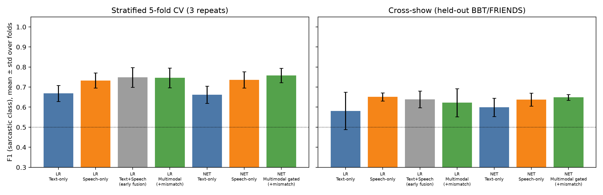
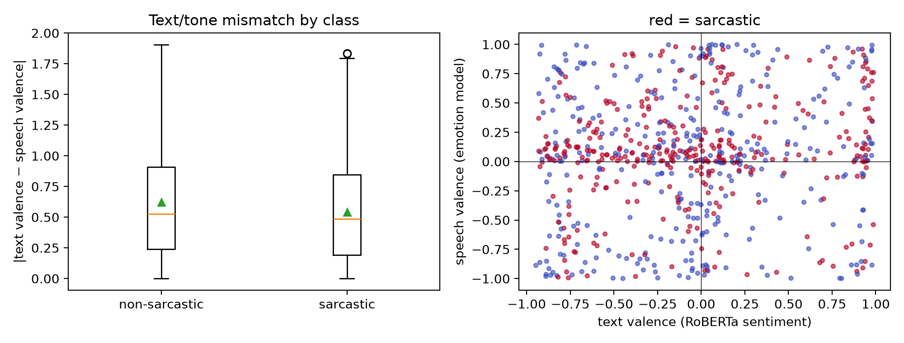
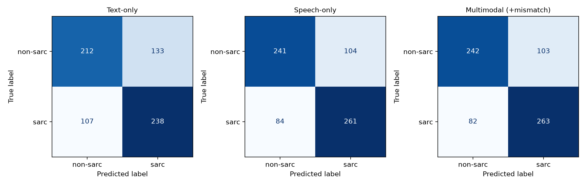

# SarcasTone: Multimodal Sarcasm Detection Using Text and Speech Prosody
*Auto-generated 2026-11-19 21:23 — numbers below come from this run; re-read them before copying into the paper.*

## Research question
How effectively can combining textual information and speech prosody improve sarcasm detection when the speaker's tone contradicts the literal meaning of the words?

# Method

## 1. Task and data
Binary sarcasm detection on **MUStARD** (Castro et al., ACL 2019): 690 audiovisual utterances from *Friends*, *The Big Bang Theory*, *The Golden Girls* and
*Sarcasmaholics Anonymous* (345 sarcastic / 345 non-sarcastic; shows: FRIENDS (356), BBT (280), GOLDENGIRLS (40), SARCASMOHOLICS (14)).
Each item has the transcript of the target utterance, the preceding dialogue context, speaker, show, and the utterance video clip. We use the **utterance transcript and the utterance audio only**
(video frames are not used because the project studies text + speech prosody; context text is used only in one ablation).
Audio is extracted with ffmpeg to 16 kHz mono PCM (mean clip length 5.2 s).

## 2. Feature extraction (all encoders frozen; extracted once and cached)
| Block | Dim | Description |
|---|---|---|
| `text_emb` | 1024 | `roberta-large` mean-pooled last hidden layer of the utterance |
| `text_sent` | 3 | `cardiffnlp/twitter-roberta-base-sentiment-latest` posteriors [neg, neu, pos] ("what is said") |
| `textctx_emb` | 1024 | same encoder on the (utterance, context) sentence pair (ablation only) |
| `wavlm` | 2048 | `microsoft/wavlm-large`: mean+std over time of the average of the middle third of transformer layers |
| `prosody` | 58 | librosa: pYIN F0 (mean, P10/P90, std & range in semitones, slope, voiced fraction, jitter proxy), RMS energy (mean/std/max/dynamic range/slope, shimmer proxy), speaking rate (words/s from the transcript, articulation rate excluding pauses, onset rate), pauses (count, total, ratio, mean, max; silence gaps ≥150 ms at 30 dB), spectral centroid/flatness/rolloff/ZCR, 13 MFCC mean+std |
| `speech_emo` | 4 | `superb/wav2vec2-base-superb-er` posteriors over ['neu', 'hap', 'ang', 'sad'] ("how it is said") |
| `mismatch` | 6 | explicit incongruity features: text valence = P(pos)−P(neg); speech valence = Σ P(emotion)·v(emotion) with v(happy)=+1, v(angry/sad)=−1, v(neutral)=0; then valence difference, |difference|, product, and a polarity-flip flag (opposite signs, both |·|>0.1) |

## 3. Models (text-only vs speech-only vs multimodal)
* **Logistic regression (LR):** blocks standardised on the training fold only, clipped to ±5, each block scaled by 1/√dim so no block dominates, concatenated (early fusion); L2 strength chosen by inner 3-fold CV on the training fold (log-loss), balanced class weights.
* **Gated-fusion network (NET):** one projection (Dropout→Linear(128)→LayerNorm→GELU→Dropout(0.4)) per block; a sample-wise softmax gate over the modality blocks weights the projections; MLP head. AdamW (lr 0.001, wd 0.01), one-cycle schedule, 60 epochs, batch 64, label smoothing 0.1, average of 3 seeds. **Hyper-parameters were fixed a priori and not tuned on test folds.**
* **Text-only** = `text_emb`+`text_sent`; **Speech-only** = `wavlm`+`prosody`+`speech_emo`; **Multimodal** = all of them + `mismatch`.
* **Ablations:** remove mismatch / prosody / WavLM; prosody-only; mismatch-only (sentiment+emotion posteriors+mismatch); text with dialogue context.

## 4. Evaluation protocol
* **A. Repeated stratified 5-fold CV × 3 repeats** (random split; speakers/shows overlap between train and test — optimistic).
* **B. Cross-show test** (train on all other shows, test on each of BBT, FRIENDS — the only shows containing both classes; GOLDENGIRLS and SARCASMOHOLICS are ~100 % sarcastic and stay in training). The held-out show's speakers and acoustic conditions are unseen — the harder, more realistic setting.
* Metrics at threshold 0.5: accuracy, precision, recall, F1 (sarcastic = positive class), macro-F1; mean ± std over folds.
* **Significance:** paired bootstrap (2000 resamples) of ΔF1 on pooled out-of-fold predictions (first repeat).
* **Research-question analysis:** utterances are split by tertiles of |text valence − speech valence| (and by polarity flip) and models are compared per subset.

## 5. Reproducibility
Seed 42; GPU: NVIDIA GeForce RTX 3090 Ti; torch 2.14.1+cu132, transformers 5.23.0, librosa 1.0.1, scikit-learn 1.9.1; Python 3.12.15.
Total wall-clock of this notebook run: 10.4 min (≈ $0.04 at $0.25/h).
Data: https://github.com/soujanyaporia/MUStARD (annotations); video clips from the HuggingFace mirror `MichiganNLP/MUStARD`.

## 6. Results

### 6.1 Main comparison — stratified 5-fold CV (3 repeats)
| Model                             | Acc           | Prec          | Rec           | F1            | Macro-F1      |
|:----------------------------------|:--------------|:--------------|:--------------|:--------------|:--------------|
| LR: Text-only                     | 0.659 ± 0.040 | 0.652 ± 0.042 | 0.688 ± 0.057 | 0.668 ± 0.040 | 0.658 ± 0.040 |
| LR: Speech-only                   | 0.726 ± 0.037 | 0.714 ± 0.038 | 0.755 ± 0.052 | 0.733 ± 0.038 | 0.725 ± 0.037 |
| LR: Text+Speech (early fusion)    | 0.743 ± 0.045 | 0.730 ± 0.036 | 0.769 ± 0.069 | 0.748 ± 0.049 | 0.742 ± 0.045 |
| LR: Multimodal (+mismatch)        | 0.740 ± 0.043 | 0.725 ± 0.034 | 0.770 ± 0.074 | 0.746 ± 0.049 | 0.739 ± 0.043 |
| NET: Text-only                    | 0.663 ± 0.040 | 0.665 ± 0.041 | 0.661 ± 0.055 | 0.662 ± 0.043 | 0.663 ± 0.040 |
| NET: Speech-only                  | 0.735 ± 0.037 | 0.733 ± 0.034 | 0.740 ± 0.057 | 0.736 ± 0.040 | 0.735 ± 0.037 |
| NET: Multimodal gated (+mismatch) | 0.755 ± 0.033 | 0.748 ± 0.032 | 0.770 ± 0.055 | 0.758 ± 0.036 | 0.755 ± 0.033 |

### 6.2 Main comparison — cross-show (held-out BBT, FRIENDS; mean ± std over 2 folds)
| Model                             | Acc           | Prec          | Rec           | F1            | Macro-F1      |
|:----------------------------------|:--------------|:--------------|:--------------|:--------------|:--------------|
| LR: Text-only                     | 0.540 ± 0.045 | 0.497 ± 0.074 | 0.699 ± 0.123 | 0.581 ± 0.093 | 0.530 ± 0.030 |
| LR: Speech-only                   | 0.606 ± 0.104 | 0.568 ± 0.070 | 0.793 ± 0.191 | 0.651 ± 0.020 | 0.560 ± 0.163 |
| LR: Text+Speech (early fusion)    | 0.598 ± 0.083 | 0.558 ± 0.051 | 0.777 ± 0.215 | 0.639 ± 0.042 | 0.554 ± 0.138 |
| LR: Multimodal (+mismatch)        | 0.586 ± 0.057 | 0.543 ± 0.024 | 0.757 ± 0.243 | 0.622 ± 0.070 | 0.545 ± 0.107 |
| NET: Text-only                    | 0.556 ± 0.027 | 0.514 ± 0.061 | 0.720 ± 0.013 | 0.599 ± 0.046 | 0.549 ± 0.022 |
| NET: Speech-only                  | 0.601 ± 0.008 | 0.550 ± 0.045 | 0.760 ± 0.005 | 0.638 ± 0.032 | 0.596 ± 0.002 |
| NET: Multimodal gated (+mismatch) | 0.604 ± 0.011 | 0.551 ± 0.028 | 0.791 ± 0.017 | 0.649 ± 0.014 | 0.596 ± 0.020 |

Pooled over all held-out utterances:
| Model                            |   acc |   precision |   recall |    f1 |   macro_f1 |
|:---------------------------------|------:|------------:|---------:|------:|-----------:|
| LR|Text-only                     | 0.536 |       0.496 |    0.695 | 0.579 |      0.531 |
| LR|Speech-only                   | 0.615 |       0.557 |    0.788 | 0.652 |      0.61  |
| LR|Text+Speech (early fusion)    | 0.605 |       0.55  |    0.771 | 0.642 |      0.601 |
| LR|Multimodal (+mismatch)        | 0.591 |       0.539 |    0.75  | 0.628 |      0.587 |
| NET|Text-only                    | 0.553 |       0.51  |    0.719 | 0.597 |      0.548 |
| NET|Speech-only                  | 0.601 |       0.547 |    0.76  | 0.636 |      0.597 |
| NET|Multimodal gated (+mismatch) | 0.605 |       0.549 |    0.791 | 0.648 |      0.599 |

### 6.3 Ablations (CV)
| Model                      | Acc           | Prec          | Rec           | F1            | Macro-F1      |
|:---------------------------|:--------------|:--------------|:--------------|:--------------|:--------------|
| LR: Multimodal (+mismatch) | 0.740 ± 0.043 | 0.725 ± 0.034 | 0.770 ± 0.074 | 0.746 ± 0.049 | 0.739 ± 0.043 |
| LR: Multimodal -mismatch   | 0.743 ± 0.045 | 0.730 ± 0.036 | 0.769 ± 0.069 | 0.748 ± 0.049 | 0.742 ± 0.045 |
| LR: Multimodal -prosody    | 0.736 ± 0.045 | 0.726 ± 0.039 | 0.758 ± 0.071 | 0.741 ± 0.049 | 0.736 ± 0.045 |
| LR: Multimodal -WavLM      | 0.727 ± 0.034 | 0.717 ± 0.030 | 0.750 ± 0.057 | 0.732 ± 0.037 | 0.726 ± 0.034 |
| LR: Prosody-only           | 0.690 ± 0.033 | 0.676 ± 0.028 | 0.729 ± 0.055 | 0.701 ± 0.037 | 0.690 ± 0.032 |
| LR: Mismatch-only          | 0.627 ± 0.042 | 0.628 ± 0.042 | 0.623 ± 0.065 | 0.625 ± 0.047 | 0.626 ± 0.042 |
| LR: Text+Context           | 0.669 ± 0.039 | 0.668 ± 0.037 | 0.677 ± 0.087 | 0.670 ± 0.049 | 0.668 ± 0.039 |
| LR: Text-only              | 0.659 ± 0.040 | 0.652 ± 0.042 | 0.688 ± 0.057 | 0.668 ± 0.040 | 0.658 ± 0.040 |

### 6.4 Ablations (cross-show)
| Model                      | Acc           | Prec          | Rec           | F1            | Macro-F1      |
|:---------------------------|:--------------|:--------------|:--------------|:--------------|:--------------|
| LR: Multimodal (+mismatch) | 0.586 ± 0.057 | 0.543 ± 0.024 | 0.757 ± 0.243 | 0.622 ± 0.070 | 0.545 ± 0.107 |
| LR: Multimodal -mismatch   | 0.598 ± 0.083 | 0.558 ± 0.051 | 0.777 ± 0.215 | 0.639 ± 0.042 | 0.554 ± 0.138 |
| LR: Multimodal -prosody    | 0.584 ± 0.013 | 0.533 ± 0.023 | 0.766 ± 0.088 | 0.629 ± 0.046 | 0.569 ± 0.033 |
| LR: Multimodal -WavLM      | 0.594 ± 0.082 | 0.557 ± 0.053 | 0.764 ± 0.262 | 0.629 ± 0.060 | 0.541 ± 0.144 |
| LR: Prosody-only           | 0.594 ± 0.129 | 0.572 ± 0.100 | 0.757 ± 0.233 | 0.633 ± 0.024 | 0.537 ± 0.195 |
| LR: Mismatch-only          | 0.590 ± 0.024 | 0.544 ± 0.062 | 0.673 ± 0.068 | 0.601 ± 0.065 | 0.587 ± 0.021 |
| LR: Text+Context           | 0.538 ± 0.038 | 0.503 ± 0.014 | 0.576 ± 0.199 | 0.528 ± 0.080 | 0.536 ± 0.039 |
| LR: Text-only              | 0.540 ± 0.045 | 0.497 ± 0.074 | 0.699 ± 0.123 | 0.581 ± 0.093 | 0.530 ± 0.030 |

### 6.5 Significance of multimodal vs unimodal (ΔF1, paired bootstrap)
| protocol   | model_a                          | model_b                 |   delta_f1 |   ci_low |   ci_high |   p_value |
|:-----------|:---------------------------------|:------------------------|-----------:|---------:|----------:|----------:|
| cv         | LR|Multimodal (+mismatch)        | LR|Text-only            |      0.075 |    0.04  |     0.111 |     0     |
| cv         | LR|Multimodal (+mismatch)        | LR|Speech-only          |      0.005 |   -0.022 |     0.031 |     0.699 |
| cv         | LR|Multimodal (+mismatch)        | LR|Multimodal -mismatch |      0.005 |   -0.008 |     0.018 |     0.537 |
| cv         | NET|Multimodal gated (+mismatch) | NET|Text-only           |      0.088 |    0.048 |     0.128 |     0     |
| cv         | NET|Multimodal gated (+mismatch) | NET|Speech-only         |      0.012 |   -0.013 |     0.04  |     0.379 |
| loso       | LR|Multimodal (+mismatch)        | LR|Text-only            |      0.048 |    0.011 |     0.088 |     0.015 |
| loso       | LR|Multimodal (+mismatch)        | LR|Speech-only          |     -0.025 |   -0.052 |     0.004 |     0.093 |
| loso       | LR|Multimodal (+mismatch)        | LR|Multimodal -mismatch |     -0.014 |   -0.035 |     0.005 |     0.149 |
| loso       | NET|Multimodal gated (+mismatch) | NET|Text-only           |      0.051 |    0.011 |     0.09  |     0.01  |
| loso       | NET|Multimodal gated (+mismatch) | NET|Speech-only         |      0.012 |   -0.018 |     0.041 |     0.428 |

### 6.6 Text/tone mismatch analysis (CV out-of-fold predictions)
| subset                       |   n |   LR|Multimodal (+mismatch) |   LR|Speech-only |   LR|Text-only |   NET|Multimodal gated (+mismatch) |   NET|Text-only |
|:-----------------------------|----:|----------------------------:|-----------------:|---------------:|-----------------------------------:|----------------:|
| high mismatch (top 1/3)      | 230 |                       0.689 |            0.72  |          0.59  |                              0.73  |           0.639 |
| low mismatch (bottom 1/3)    | 230 |                       0.781 |            0.754 |          0.721 |                              0.778 |           0.696 |
| mid mismatch                 | 230 |                       0.741 |            0.73  |          0.68  |                              0.756 |           0.667 |
| no polarity flip             | 488 |                       0.751 |            0.738 |          0.671 |                              0.758 |           0.668 |
| polarity flip (text vs tone) | 202 |                       0.711 |            0.728 |          0.651 |                              0.749 |           0.667 |

## 7. Key findings (auto-generated from the numbers above)
- **stratified CV, LR:** multimodal F1 0.746 vs text-only 0.668 and speech-only 0.733; ΔF1 vs text = +0.075 (95% bootstrap CI [+0.040, +0.111]) → a statistically reliable gain.
- **stratified CV, gated net:** multimodal F1 0.758 vs text-only 0.662 and speech-only 0.736; ΔF1 vs text = +0.088 (95% bootstrap CI [+0.048, +0.128]) → a statistically reliable gain.
- **cross-show, LR:** multimodal F1 0.622 vs text-only 0.581 and speech-only 0.651; ΔF1 vs text = +0.048 (95% bootstrap CI [+0.011, +0.088]) → a statistically reliable gain.
- **cross-show, gated net:** multimodal F1 0.649 vs text-only 0.599 and speech-only 0.638; ΔF1 vs text = +0.051 (95% bootstrap CI [+0.011, +0.090]) → a statistically reliable gain.
- **Contradiction subset (RQ):** in the top-third text/tone-mismatch utterances (n=230) multimodal F1 = 0.689 vs text-only 0.590 (gain +0.099); in the bottom third (n=230) multimodal 0.781 vs text-only 0.721 (gain +0.060).
- **Mismatch signal:** mean |text valence − speech valence| is 0.542 for sarcastic vs 0.623 for non-sarcastic utterances (Mann–Whitney p = 0.0407); polarity-flip rate 28.1% vs 30.4%.
- **Learned modality weights (gated net, CV):** text_emb=0.31, text_sent=0.00, wavlm=0.68, prosody=0.00, speech_emo=0.00, mismatch=0.00.

## 8. Limitations (state these in the paper)
* **Small dataset** (690 utterances) → high variance; fold std and bootstrap CIs are reported; differences within CI are not evidence.
* **Show/speaker confound & laugh tracks:** sitcom audio contains canned laughter and show-specific acoustics; models may exploit these instead of prosody. The cross-show test partly controls for this; note that in MUStARD the show is correlated with the label (GOLDENGIRLS/SARCASMOHOLICS are almost all sarcastic), so random-split CV can be inflated by show identity.
* **Domain shift of the pretrained emotion model** (trained on acted IEMOCAP-style speech) → the speech valence used for the mismatch features is noisy.
* **Fixed hyper-parameters** (no test-set tuning) — may under-fit the neural head; CV repeats are not independent, so CV standard deviations are optimistic.
* Context and video are not used in the main models; sarcasm often needs dialogue context (see Text+Context ablation).

## References
[1] S. Castro, D. Hazarika, V. Pérez-Rosas, R. Zimmermann, R. Mihalcea, S. Poria, "Towards multimodal sarcasm detection (an *obviously* perfect paper)," in *Proc. ACL*, 2019, pp. 4619–4629.
[2] Y. Liu *et al.*, "RoBERTa: A robustly optimized BERT pretraining approach," arXiv:1907.11692, 2019.
[3] S. Chen *et al.*, "WavLM: Large-scale self-supervised pre-training for full stack speech processing," *IEEE J. Sel. Topics Signal Process.*, vol. 16, no. 6, 2022.
[4] S. Yang *et al.*, "SUPERB: Speech processing universal performance benchmark," in *Proc. Interspeech*, 2021.
[5] M. Mauch and S. Dixon, "pYIN: A fundamental frequency estimator using probabilistic threshold distributions," in *Proc. ICASSP*, 2014.
[6] B. McFee *et al.*, "librosa: Audio and music signal analysis in Python," in *Proc. SciPy*, 2015.
[7] A. Ray, S. Mishra, A. Nunna, P. Bhattacharyya, "A multimodal corpus for emotion recognition in sarcasm," in *Proc. LREC*, 2022 (MUStARD++, suggested extension).
